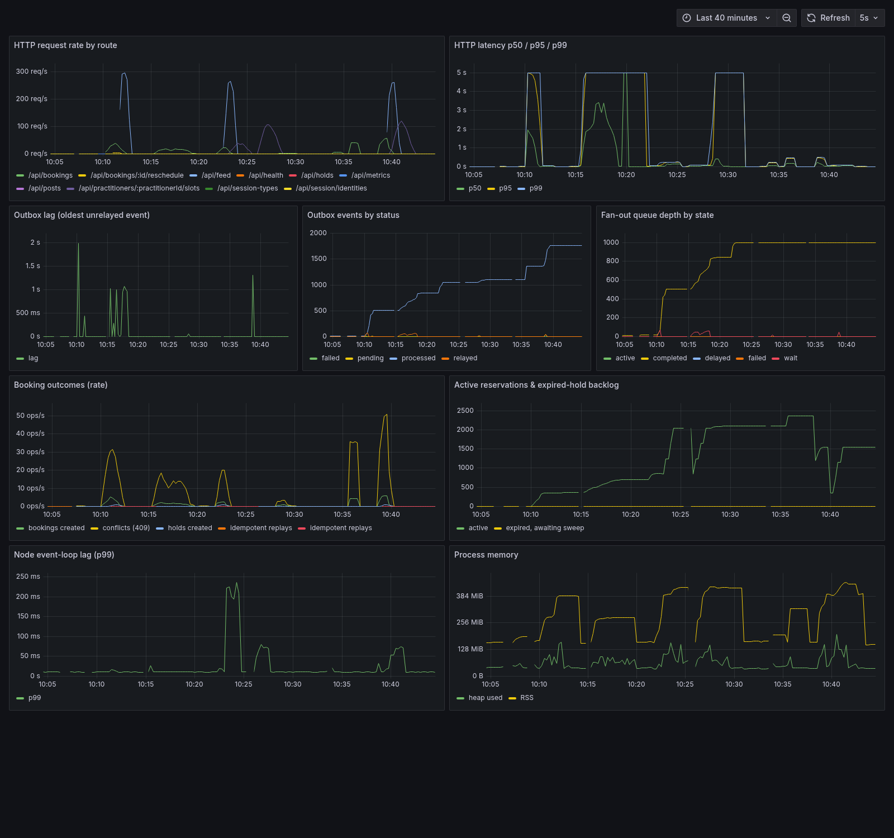

# Tangerine — Performance methodology

This directory is the evidence for the roadmap in `Feature List.md`. Every
scenario has a hypothesis, a reproducible methodology, raw k6 artifacts, an
analysis with tool output, and — where an optimization was warranted — a
before/after. A feature is only "done" when it appears here.

Raw artifacts: `apps/api/performance/results/<run>/` (k6 summary JSON).
Charts: `docs/performance/assets/` (rendered by
`apps/api/performance/report.mjs`).

## 1. Machine spec

Recorded so results are reproducible; do not mix runs across machines.

| | |
| --- | --- |
| Host | AMD Ryzen 7 5700U (8 cores / 16 threads, 411–4374 MHz) |
| RAM | 13 GiB |
| Storage | 475 GiB SSD (`/dev/mapper/root`); Postgres + Redis on local volumes |
| OS / kernel | Omarchy (Arch), `7.1.8-arch1-3`, x86_64 |
| Node.js | v25.2.1 |
| pnpm | 11.10.0 |
| Docker | 29.7.2 |
| Postgres | `postgres:18-alpine`, `shared_preload_libraries=pg_stat_statements`, `track_io_timing=on`, `max_connections=200` |
| Redis | `redis:7-alpine`, AOF on |
| k6 | v2.3.0 |
| Monitoring | `prom/prometheus:v3.1.0`, `grafana/grafana:11.5.1` (host network) |

Everything runs on one host: the API, Postgres, Redis, Prometheus, Grafana and
the k6 generator share 8 physical cores. That is a **ceiling**, not a detail —
contention for CPU between the load generator and the server is part of every
number below.

## 2. Fixed load parameters

- Dataset: `pnpm db:reset && pnpm db:seed` — 36 users, 166 follows, 2
  celebrities (threshold 15), ~120 posts, 12 practitioners with session types
  and Mon–Fri availability.
- Synthetic slot-lookup data: `pnpm --filter @tangerine/api perf:seed-bookings`
  (`BOOKING_COUNT`, `SLOT_MINUTES`).
- Auth: mock `x-user-id`; ids resolved at `setup()` from
  `/api/session/identities`, so scripts are portable across reseeds.
- Warm-up: scenarios that read derived state warm it first (feed posts; slot
  lookups occur on a primed calendar).
- Load profiles are per-scenario and stated in each write-up.

## 3. What we measure

Each scenario file follows: **Hypothesis → Methodology → Results → Analysis →
Optimization → Results after → What it proves.** Analysis always cites a tool
output: `EXPLAIN ANALYZE`, `pg_stat_statements`, server error logs, Prometheus
metrics, or the k6 artifact — never a guess.

## 4. Metrics surfaces

- Application: `GET /api/metrics` — HTTP latency histogram, outbox lag + status
  counts, fan-out queue depth, booking outcomes
  (created / holds / conflicts / idempotent replays), active reservations,
  expired-hold backlog, Node event-loop lag, heap + RSS.
- Postgres: `pg_stat_statements`, `pg_stat_activity`, `EXPLAIN (ANALYZE,
  BUFFERS)`.
- Redis: `SLOWLOG`, `INFO`, key counts by pattern.
- k6: summary JSON per run.

## 5. Scenario index

### Scheduling & booking (new capability)

| Scenario | Script | Status | Headline |
| --- | --- | --- | --- |
| Booking contention | `booking-contention.js` | measured + optimized | 10-way race: **exactly 1 winner, 0 `5xx`, race p95 0.9 s** (baseline had 230 `5xx`) |
| Slot lookup under load | `slot-lookup.js` | measured + optimized | the bottleneck was the timezone parse, not the scan: **p95 306 → 77 ms** |
| Reschedule idempotency | `reschedule-idempotency.js` | measured | 100/100 no-ops, replay p95 29 ms |
| Hold expiry accuracy | `hold-expiry.js` | measured | released within **≈ 234 ms** of a 5 s TTL |

### Existing system

| Scenario | Script | Status | Headline |
| --- | --- | --- | --- |
| Feed read throughput | `feed-read.js` | measured | **597 req/s**, p95 41 ms, 0 % errors |

### Visuals



Captured from the provisioned Grafana stack (`http://localhost:3000/d/tangerine-api`)
during and after the benchmark runs. Charts also live in
`docs/performance/assets/` and are embedded in each write-up:

- `booking-contention-latency.svg` — write latency under a 10-way slot race.
- `slot-lookup-scaling.svg` / `-after.svg` — the timezone-cache optimization.
- `hold-expiry-latency.svg` — slot release latency vs TTL.
- `feed-read-latency.svg` — warm feed percentiles.

The Prometheus scrape config is in `infra/prometheus/prometheus.yml`.

## 6. Run it

```bash
pnpm infra:up
pnpm db:seed
RUN_STAMP=local bash apps/api/performance/run-scheduling.sh
node apps/api/performance/report.mjs apps/api/performance/results/local
```

Grafana dashboard: <http://localhost:3000/d/tangerine-api> (provisioned;
anonymous viewer enabled). Prometheus: <http://localhost:9090>.

## 7. Optimization log

Chronological before/after lives in `docs/performance/optimization-log.md`.

## 8. References

Grounding for the scheduling design and the contention findings:

- PostgreSQL docs — [Exclusion Constraints](https://www.postgresql.org/docs/current/ddl-constraints.html#DDL-CONSTRAINTS-EXCLUSION)
  and [Transaction Isolation](https://www.postgresql.org/docs/current/transaction-iso.html).
- PostgreSQL mailing list — [deadlock when using exclusion constraints / BUG #15026](https://www.postgresql.org/message-id/69d128a8524692d0610ae3118580c859.squirrel%40mail.pinkwin.com):
  GiST exclusion inserts can deadlock, and with 3+ concurrent sessions a naive
  retry loop may never terminate. The suggested remedy is an exclusive lock on a
  shared entity before the `INSERT` — implemented here as an advisory lock keyed
  by `(practitioner, slot)`.
- Franck Pachot — [Avoiding range overlaps with EXCLUDE constraints](https://dev.to/franckpachot/postgresql-exclude-constraints-for-better-concurrency-than-serializable-pob):
  `23P01` for an overlap and `40P01` for the resulting deadlock; only true
  overlaps block.
- [PostgreSQL: Making Double Bookings Impossible](https://gemsofcoding.com/Postgres-No-Double-Booking/)
  and [Postgres EXCLUDE Constraints](https://the-practical-developer.online/posts/postgres-exclude-constraints-stop-double-booking/):
  `EXCLUDE USING gist`, `btree_gist`, partial `WHERE (status <> 'cancelled')`,
  and mapping `23P01` to `409`.
- [Designing a Reservation and Booking System](https://letsbuildsolutions.com/blog/system-design/designing-a-reservation-and-booking-system-inventory-holds-double-booking-prevention-and-concurrency-control/):
  discrete slot rows with `UNIQUE (resource_id, starts_at)` and `ON CONFLICT`
  for the highest-concurrency path; the constraint as the last line of defence.
- Grafana k6 docs — [`http.batch`](https://grafana.com/docs/k6/latest/javascript-api/k6-http/batch/):
  `batch` defaults to 20 and `batchPerHost` to 6, so a same-host "10-way race"
  must raise `batchPerHost` or it is only 6-way.
- Prisma docs — connection pool (`connection_limit`, `pool_timeout`) and
  interactive transaction timeouts.

