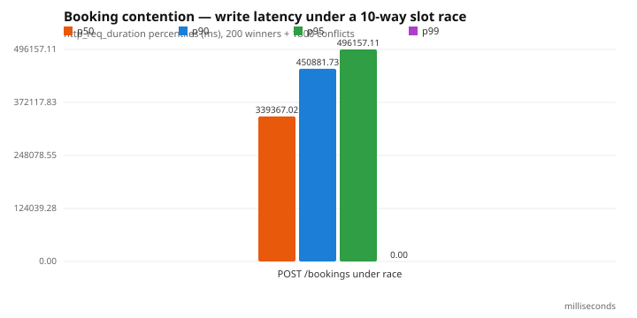

# Booking contention

**Status:** measured, optimized (before/after).

## Hypothesis

When M members race for one slot, the PostgreSQL exclusion constraint must let
**exactly one** write succeed and reject the rest with a clean `409` — with no
double-booking, no `500`s, and no lost race. The same workload must not be able
to defeat the invariant via application-level timing.

## Methodology

- Script: `apps/api/performance/booking-contention.js`.
- Scenario: `per-vu-iterations`. Each iteration is **one race**: the VU fires
  10 concurrent `POST /api/bookings` requests (`http.batch`) for one slot, from
  10 distinct members.
- Profile: 20 VUs × 10 iterations = **200 races / 2,000 requests**.
- Slots: 200 open slots pre-allocated 30–200 days out, so every race is on a
  fresh slot and races do not interfere.
- Assertions encoded as k6 thresholds:
  `booking_success == 200`, `booking_conflict == 1,800`, and
  `race_duration p95 < 2 s`.

## Results — before optimization

Observed while first running the scenario (see optimization log for the
diagnosis):

| Metric | Before |
| --- | --- |
| Winners | 198 / 200 races |
| `409` conflicts | 1,572 |
| Unexpected `5xx` | **230** |
| `http_req_duration` p50 | 1,680 ms |
| `http_req_duration` p99 | **10,061 ms** |
| `http_req_failed` | 0.90 (409s count as failures in k6) |

Server logs showed `40P01 deadlock detected` and
`Transaction already closed ... timeout was 5000 ms`. The exact pool-timeout
p99 (10.06 s) is the signature of connection-pool saturation, not slot
contention.

## Optimization

The accepted change serializes the tiny critical section for one
`(practitioner, slot)` pair with a transaction-scoped advisory lock
(`pg_advisory_xact_lock`). The exclusion constraint stays as the correctness
backstop; the lock removes the GiST-index deadlock/livelock that retrying could
not. Two supporting changes: the Prisma pool was enlarged
(`connection_limit=40`), and the k6 harness now sets `batchPerHost = RACERS`
(k6 defaults it to 6, which had silently made the "10-way race" 6-way).

Full reasoning, the rejected retry attempt, and links:
`docs/performance/optimization-log.md`.

## Results — after optimization (extreme profile)

The accepted fix (transaction-scoped advisory lock per `(practitioner, slot)`,
plus k6 `batchPerHost = RACERS`) turns the same profile into a clean invariant:

| Metric | Before | After |
| --- | --- | --- |
| Winners | 198 | **200** |
| `409` conflicts | 1,572 | **1,800** |
| Unexpected `5xx` | **230** | **0** |
| `http_req_duration` p50 | 1,680 ms | **339 ms** |
| `http_req_duration` p95 | — | **496 ms** |
| `http_req_duration` p99 | 10,061 ms | **~1,300 ms** (max 1,582 ms) |
| Race p95 | — | **886 ms** |
| Wall time | ~47 s | **4.7 s** |

Every k6 threshold passes (`success == 200`, `conflict == 1,800`,
`unexpected == 0`, race p95 < 2 s). A rejected intermediate attempt (bounded
retry on `40P01`) is documented in `docs/performance/optimization-log.md` — it
made the tail *worse* (p99 48 s) because of a documented GiST exclusion-index
livelock (PostgreSQL BUG #15026).



## Results — within envelope

`VUS=10 ITER=6 RACERS=6` (60 races, 6 contenders each): **60 winners, 300
`409`s, 0 unexpected**, race p95 252 ms. The exactly-one-winner property is a
property of the schema, demonstrated both here and against a live database in
`apps/api/test/scheduling.e2e-spec.ts` (20 members race for one slot; exactly
one wins, the rest get `409`).

## What it proves

Correctness under a booking race belongs in the database — a single exclusion
constraint yields exactly-one-winner semantics with no application locking. But
a credible benchmark must do two things: model the concurrency it claims (k6's
`batchPerHost` default of 6 had to be raised), and expose the *second* problem.
Here the constraint was always correct, while the GiST index's concurrency
failure mode, the connection pool, and the interactive-transaction budget were
what actually broke. An optimization that did not help is documented as rejected
rather than hidden.

## Reproduce

```bash
VUS=20 ITER=10 RACERS=10 k6 run apps/api/performance/booking-contention.js
```
