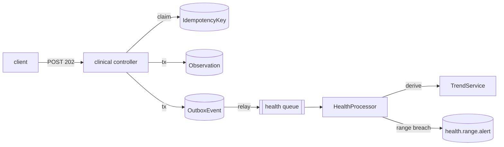

# Health monitoring — ingestion, trends, adherence

**Status:** measured + optimized (k6 against the live API, Postgres as arbiter).

Machine and fixed parameters are in `docs/performance/README.md`. Diagrams are
[Mermaid](https://mermaid.js.org/) (rendered by the markdown host). Raw
artifacts: `apps/api/performance/results/health-final/` (before optimization)
and `apps/api/performance/results/health-after/` (adherence re-run after the
change).

## Hypothesis

The health feature is three different load shapes on one write path, and the
interesting question is **where the bottleneck sits**:

- **Ingestion is a write-amplifying path.** One `POST /api/clinical/observations`
  is an idempotency claim, an `Observation` insert and an `OutboxEvent` insert —
  three writes per request — and a range alert must be derived later. The
  hypothesis is that the request path is bound by the database, and that the
  outbox relay + worker keep up at low-to-moderate rates but become the ceiling
  when ingestion is sustained.
- **Trend reads should be flat.** Trends are *derived on read* (never stored) by
  scanning a `(patientId, code)` index backwards for the recent window. The
  hypothesis is that read cost is independent of the patient's total history.
- **Adherence should scale with the window, not the dataset.** The naive
  implementation filters the window's events once per protocol item; the
  hypothesis is that this is O(items × events) and shows up superlinearly.
- **FHIR bundles and concurrent writers** should behave like the single-observation
  path scaled by bundle size, with no new failure modes.



## Methodology

Dataset: seeded synthetic population (`pnpm --filter @tangerine/api prisma:seed-health`),
100 patients and ~6.3k observations. Scaling scenarios seed their own patient via
`pnpm --filter @tangerine/api perf:seed-health` (`MODE=trend` / `MODE=adherence`),
inserting rows with `generate_series` so the *row count*, not the request path, is
what varies.

| Scenario | Script | Load |
| --- | --- | --- |
| Observation ingestion | `health-observation-ingestion.js` | 20 VUs, 30 s |
| FHIR bundle ingestion | `health-fhir-bundle-ingestion.js` | 10 VUs, 30 s, 3 obs/bundle |
| Concurrent sources | `health-concurrent-sources.js` | 15 VUs, 30 s, mixed obs + adherence |
| Trend query scaling | `health-trend-query.js` | 4 VUs × 200 iters at 1k / 10k / 100k / 500k rows |
| Adherence rate scaling | `health-adherence-rate.js` | 4 VUs × 30 iters at (20 items,10k) / (50,25k) / (100,50k) |

The runner (`apps/api/performance/run-health.sh`) samples `OutboxEvent` lag every
second during ingestion, waits for the outbox to drain afterwards, and captures
`EXPLAIN (ANALYZE, BUFFERS)` for the trend query at each size.

## Results

### Observation ingestion

| Metric | Value |
| --- | --- |
| Requests | **4,118** in 30 s → **137 req/s** |
| Failures | **0** |
| p50 / p90 / p95 | **82 / 257 / 300 ms** |
| max | 3,798 ms |
| Outbox pending, peak (1 s samples) | **425** |
| Outbox drained | **1.79 s** after writers stopped |

4118 × 3 writes ≈ **12.4k writes in 30 s ≈ 412 writes/s** absorbed by one Postgres.

### FHIR bundle ingestion

| Metric | Value |
| --- | --- |
| Requests | 3,485 → **116 req/s** (×3 obs = **347 obs/s** enqueued) |
| Failures | **0** |
| p50 / p90 / p95 | **64 / 85 / 99 ms** |
| max | 2,065 ms |

### Concurrent sources (observation + adherence interleaved)

| Metric | Value |
| --- | --- |
| Requests | 6,618 → **220 req/s** |
| Failures | **0** |
| p50 / p90 / p95 | **65 / 81 / 88 ms** |
| max | 513 ms |

### Trend query scaling

| History rows | p50 | p90 | p95 | max |
| --- | --- | --- | --- | --- |
| 1,000 | 5.6 ms | 7.4 ms | 8.1 ms | 13.3 ms |
| 10,000 | 6.2 ms | 7.7 ms | 8.2 ms | 15.8 ms |
| 100,000 | 6.1 ms | 8.1 ms | 8.6 ms | 15.4 ms |
| 500,000 | 5.7 ms | 7.1 ms | 7.7 ms | 33.7 ms |

Flat to within noise across a **500×** increase in stored history.

### Adherence rate scaling (before)

| (items, events) | p50 | p90 | p95 | avg |
| --- | --- | --- | --- | --- |
| 20, 10,000 | 196 ms | 303 ms | 325 ms | 208 ms |
| 50, 25,000 | 607 ms | 897 ms | 1,028 ms | 634 ms |
| 100, 50,000 | 1,596 ms | 2,232 ms | 2,549 ms | 1,606 ms |

Doubling both inputs roughly triples the latency — the signature of a product,
not a sum.

## Analysis

**Trend reads are index-bound, and the index is doing exactly its job.** The
`EXPLAIN (ANALYZE, BUFFERS)` at 500k rows:

```
Limit  (cost=7.18..10.68 rows=1) (actual time=0.153..0.164 rows=1.00)
  ->  Incremental Sort  (Sort Key: effectiveAt DESC, issuedAt DESC)
        ->  Index Scan Backward using "Observation_patientId_code_effectiveAt_idx"
              Index Cond: (patientId = ... AND code = '8867-4' AND effectiveAt <= now())
              actual time=0.087..0.088 rows=2  Buffers: shared hit=9
```

The scan touches **9 buffers** and returns in **0.088 ms** regardless of the
table size, because "the recent window" is a bounded backward walk from the
index tail. Derivation-on-read is cheap *because* the access pattern matches the
index order — no counter table is needed.

**The ingestion bottleneck is the write, and the sustained ceiling is the
worker.** At 20 VUs the request path accepted 137 req/s with zero failures; the
outbox stayed shallow (peak 425) and drained in 1.79 s, so the relay and worker
kept pace *for that burst*. Across the whole run, however, the accumulated
`OutboxEvent` backlog reached ~11k and drained at roughly **100 events/s** — the
worker derives the trend for **every** observation (a read per event) before it
marks the row processed, so it consumes more slowly than the write path produces.
Below ~100 events/s the backlog is invisible; sustained ingestion above it grows
the outbox without bound. The bottleneck therefore **moves**: the request path is
bound by Postgres writes, and the pipeline's honest limit is the single
`HealthProcessor` consumer.

**The adherence path was quadratic by construction.** `AdherenceService` fetched
the window's events once, then ran `events.filter(e => e.protocolItemKey ===
item.key)` **per item** — O(items × events). The README's clinical rule (a
missing day is *not logged*, an explicit skip is *missed*) is computed per item
and does not need that nesting; the events can be bucketed by key a single time.

**FHIR bundles and concurrent writers add no new failure mode.** Bundle latency
(p95 99 ms) tracks single-observation latency scaled by three inserts; the mixed
workload reached the highest throughput of all (220 req/s) with the lowest tail
(p95 88 ms) because the adherence posts are cheap writes beside the observation
writes. Zero `5xx` anywhere — the idempotency claim serialises duplicate keys and
the outbox commit keeps row + event atomic.

## Optimization

**Bucket the window's adherence events by item once — O(items × events) →
O(events + items).**

In `apps/api/src/clinical/adherence.service.ts`, the per-item filter was replaced
by a single pass that groups the window's events into a `Map<key, event[]>`; each
item then reads its own bucket. The clinical semantics are unchanged (taken /
skipped / not-logged / streaks all read from the same per-item event list).

Relay and worker throughput were **diagnosed but deliberately not "fixed" here**:
raising consumer concurrency is a deployment knob (BullMQ worker concurrency),
and the scenario's job was to locate the ceiling, not to paper over it. It is
recorded in the optimization log as the recommended next lever.

## Results after

Same seeds, same 4 VUs × 30 iters, re-run with the change live
(`results/health-after/`):

| (items, events) | avg before | avg after | p95 before | p95 after |
| --- | --- | --- | --- | --- |
| 20, 10,000 | 208 ms | **179 ms** | 325 ms | **283 ms** |
| 50, 25,000 | 634 ms | **492 ms** | 1,028 ms | **667 ms** |
| 100, 50,000 | 1,606 ms | **905 ms** | 2,549 ms | **1,311 ms** |

At the largest configuration that is **1.77× the throughput** and p95 nearly
halved. What remains is the cost of returning the window's rows themselves — now
**linear in the data volume**, which is the floor for a derived-on-read endpoint,
not a product of items and events.

## What it proves

- **Derivation over storage pays off when the read matches the index.** Trends
  are computed on every request with no stored rollups and stay at ~8 ms p95 from
  1k to 500k rows, because the recent window is a bounded index walk.
- **Atomic row + outbox gives clean ingestion.** 12.4k writes in 30 s with zero
  failures; idempotency claims absorb duplicates and the outbox keeps the write
  and its follow-up consistent.
- **Throughput has two ceilings, and the interesting one moves.** The request
  path saturates on Postgres writes (~400 writes/s here); the *sustained* limit
  is the single worker consuming derived-state events (~100/s). Measuring only
  the request path would have hidden it.
- **Benchmarking finds constructions, not just slow queries.** The adherence
  endpoint's quadratic filter was invisible at demo sizes and only appeared when
  items and events were both grown — and bucketing restored linearity with no
  change to behaviour.

## Reproduce

```bash
docker compose up -d
pnpm --filter @tangerine/api prisma:seed-health
pnpm --filter @tangerine/api dev                 # API on :3001
RUN_STAMP=local bash apps/api/performance/run-health.sh
```

Focused re-runs use the same env knobs as the runner
(`TREND_COUNTS`, `ADH_CONFIGS`, `INGEST_VUS`, …); the adherence "after" artifacts
were produced with `ADH_CONFIGS="20:10000 50:25000 100:50000" ADH_ITERS=30`.
