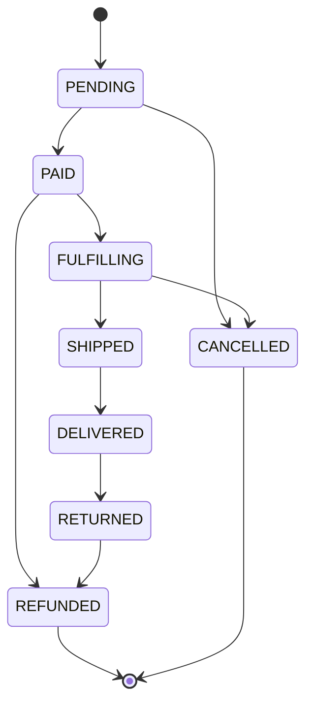
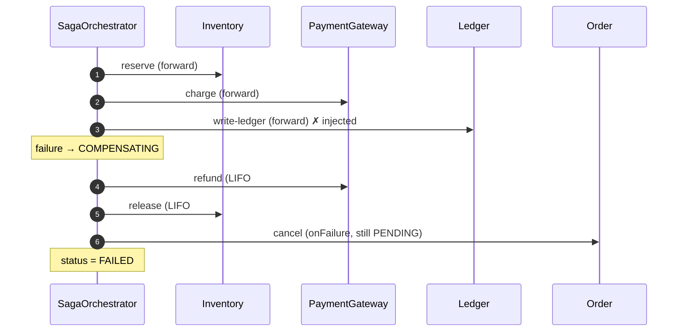

# Marketplace — inventory, cart, orders, saga

**Status:** measured (behavioral harnesses against live Postgres + API).

Machine and fixed parameters are in `docs/performance/README.md`. Diagrams are
[Mermaid](https://mermaid.js.org/) (rendered by the markdown host).

## Hypothesis

A marketplace is a set of **contention problems**, each with a different right
answer:

- **Inventory** is a hot-row count. Many checkouts race for few units; the
  invariant is `reserved ≤ quantity`, and it must hold with no application lock.
- **Cart** is a lost-update problem. Two clients editing from the same read must
  not silently clobber each other.
- **Order lifecycle** is a state machine that must reject illegal moves.
- **Checkout** is a multi-step saga (reserve → charge → ledger → confirm →
  notify) that must **compensate in reverse** if any step fails, leaving no
  half-charged order.

## Methodology

| Script | Workload |
| --- | --- |
| `test-inventory-race.sh` | 100 concurrent reservations of 1 unit against 10 units |
| `test-inventory-exhaustion.sh` | drain to zero, then 25 more concurrent attempts |
| `test-cart-concurrency.sh` | two edits presenting the same cart version |
| `test-order-state-machine.sh` | every `(current, next)` pair × 3 roles = 192 triples |
| `test-saga-compensation.sh` | force the ledger step to fail; assert LIFO compensation |
| `test-saga-failure.sh` | force **each** of the 5 steps to fail in turn |

## Results

### Inventory race

`test-inventory-race.sh`, 100 contenders, `STOCK=10`:

| Metric | Value |
| --- | --- |
| Reservations accepted | **10 / 100** (exactly the stock) |
| Batch wall time | **0.27 s** → ≈ **370 req/s** |
| `InventoryItem(reserved, quantity)` | `10, 10` |
| Invariant `reserved ≤ quantity` | held |
| `tangerine_inventory_reservations_total` | `reserved=10`, `rejected=90` |

`test-inventory-exhaustion.sh`: after draining to zero, **25** further
concurrent attempts all fail; `reserved` stays at `quantity`.

One statement is the whole mechanism:

```sql
UPDATE "InventoryItem"
SET reserved = reserved + $1, version = version + 1
WHERE "productId" = $2 AND quantity - reserved >= $1;
```

`quantity - reserved >= $1` is evaluated under the row lock, so the check and
the increment cannot interleave. No `SELECT ... FOR UPDATE`, no retry.

### Cart optimistic concurrency

`test-cart-concurrency.sh`, two edits from the same version:

| Metric | Value |
| --- | --- |
| Responses | **1 × 201**, **1 × 409** |
| Cart version | advanced by exactly **1** |
| Cart lines | **1** (the losing edit did not apply) |

### Order state machine

`test-order-state-machine.sh`, exhaustive:

| Metric | Value |
| --- | --- |
| Triples tested (`current × next × role`) | **192** |
| Legality mismatches | **0** |



Legality is role-independent in this phase (the actor is recorded, not gating);
the harness therefore asserts the same legality for all three roles.

### Checkout saga compensation

`test-saga-compensation.sh`, forced failure at `write-ledger`:

| Assertion | Result |
| --- | --- |
| Saga status | **FAILED** |
| Completed steps | `[reserve-inventory, charge-payment]` |
| Compensations (LIFO) | `[charge-payment, reserve-inventory]` |
| Inventory | released → `reserved = 0` |
| Payment | **REFUNDED** |
| Order | **CANCELLED** |
| Ledger imbalance | **0** |

`test-saga-failure.sh` forces each step; the compensation count is exactly the
number of steps that committed before the failure (0, 1, 2, 3, 4), and the
order always ends terminal (`CANCELLED` before confirmation, `REFUNDED` once the
confirmation was compensated).



## Analysis

Each problem is solved at the layer that can enforce it with the fewest moving
parts:

- **Inventory** contention is one conditional `UPDATE`; the row lock makes it
  atomic and the predicate makes over-commit unrepresentable. 100 racing writers
  produce exactly the stock — no more.
- **Cart** conflicts are a version predicate: `UPDATE ... WHERE version = ?`
  affecting 0 rows *is* the conflict signal, mapped to `409`.
- **Order** legality is a table lookup against the current status; illegal moves
  are counted (`legal=false`) and rejected.
- **Checkout** keeps step progress in `SagaState` (`completedSteps`,
  `compensationsRun`) so the run is inspectable and resumable, and compensations
  are the idempotent inverses of the forward actions (release, refund, reversing
  ledger entry).

## Optimization

- **Single-row conditional update** for inventory rather than `SELECT ... FOR
  UPDATE` + `UPDATE`: same atomicity, one round trip, no explicit lock.
- **`FOR UPDATE SKIP LOCKED`** for the expiry sweeper, so many sweepers run
  concurrently without blocking checkout.
- **`onFailure` cleanup** for the saga: a failure before confirmation cancels the
  still-`PENDING` order, which is not a compensation of a completed step but a
  terminal-state guarantee.

## What it proves

Contention is not one problem with one technique. A count is best held by a
conditional `UPDATE`; a cart by a version predicate; a lifecycle by a transition
table; and a multi-step flow by a saga whose compensations are exactly the
idempotent inverses of its steps. The harnesses fire the adversarial case (100
racing writers, forced failures at every step) and assert the invariant, not the
happy path.

## Reproduce

```bash
docker compose up -d
pnpm --filter @tangerine/api dev            # or pnpm dev:api
bash scripts/test-inventory-race.sh
bash scripts/test-inventory-exhaustion.sh
bash scripts/test-cart-concurrency.sh
bash scripts/test-order-state-machine.sh
bash scripts/test-saga-compensation.sh      # needs SAGA_FAILURE_INJECTION=1
bash scripts/test-saga-failure.sh           # needs SAGA_FAILURE_INJECTION=1
```

Or the whole suite, orchestrated by Herdr:
`bash scripts/herdr-test-suite.sh` (see §"Full suite" in the optimization log).
