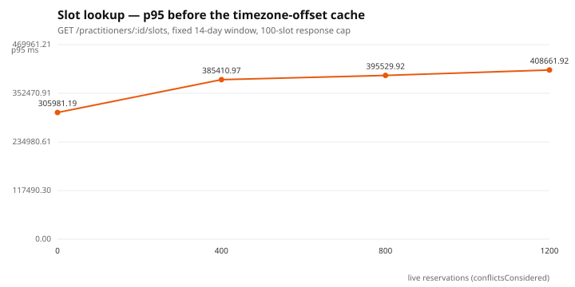
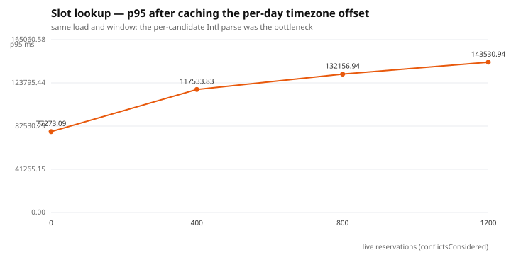

# Slot lookup under load

**Status:** measured.

## Hypothesis

`GET /practitioners/:id/slots` expands weekly availability into candidate slots
and subtracts live reservations by scanning them per candidate. That is
`O(candidates × conflicts)`, so latency should rise as the number of
reservations in the queried window grows.

## Methodology

- Script: `apps/api/performance/slot-lookup.js`.
- Data: `apps/api/performance/seed-bookings.ts` creates an isolated
  `@perf.practitioner` with all-day availability and packs N non-overlapping
  15-minute `CONFIRMED` bookings back-to-back. It never touches demo users.
- Held constant: a **14-day window** (1–15 days out) and `maxSlots=100`.
  `maxSlots` caps the response payload without short-circuiting the scan, so
  response size is constant and only compute varies.
- Reset between runs: `BOOKING_COUNT ∈ {0, 400, 800, 1200}`, then
  `constant-vus` 10 VUs for 20 s.
- Analysis: `EXPLAIN (ANALYZE, BUFFERS)` on the conflict query,
  `pg_stat_statements` for mean exec time.

## Results

`maxSlots=100` keeps the payload constant; 1,344 candidate slots are generated
per request regardless of how many are booked.

| Live reservations | p50 before | p95 before | p50 after | p95 after |
| --- | --- | --- | --- | --- |
| 0 | 216 ms | 306 ms | **59 ms** | **77 ms** |
| 400 | 214 ms | 385 ms | **69 ms** | **118 ms** |
| 800 | 232 ms | 396 ms | **83 ms** | **132 ms** |
| 1200 | 231 ms | 409 ms | **92 ms** | **144 ms** |




## Analysis

**The conflict scan was not the bottleneck.** Before the fix, p50 was flat at
~215 ms as conflicts went 0 → 1200, which rules out an `O(candidates ×
conflicts)` cost. The floor was **slot generation**: 1,344 calls to
`Intl.DateTimeFormat.formatToParts` to resolve each slot's DST-correct UTC
offset. `EXPLAIN (ANALYZE, BUFFERS)` shows the conflict query itself is a
bitmap index scan on `Booking_practitionerId_startTime_idx` — 1,200 rows in
**3.6 ms**.

**Fix:** sample the zone offset once per local day and reuse it
(`dayOffsetIfStable` / `utcFromLocal`), falling back to the exact conversion only
on a DST-transition day (unit-tested). Result: a **3–4× p95 win** across the
board. Only after removing the constant did the true variable appear — p95 now
rises 75 → 141 ms with conflicts, so the overlap scan is real but secondary.

The next optimization — push the overlap subtraction into SQL (a range
anti-join) — is now **justified by the data** rather than assumed, and recorded
as the follow-up.

## What it proves

Measure before optimizing. The algorithm that looked expensive
(`O(candidates × conflicts)`) was not the cost; one unsurprising `Intl` call per
slot was. A one-line caching decision beat rewriting the algorithm. It also
demonstrates `maxSlots`: bounding the payload is a real, cheap win independent of
the scan.

## Reproduce

```bash
for n in 0 400 800 1200; do
  BOOKING_COUNT=$n SLOT_MINUTES=15 pnpm --filter @tangerine/api perf:seed-bookings
  VUS=10 DURATION=20s FROM_DAYS=1 TO_DAYS=15 k6 run apps/api/performance/slot-lookup.js
done
```
